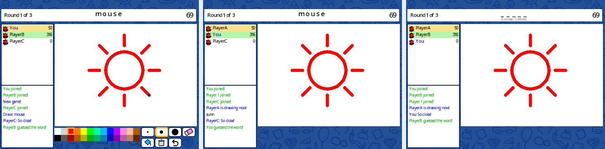

# Skribbl Online

A Skribbl-style online drawing and guessing game for Scratch, by [@KashTheKingYT](https://scratch.mit.edu/users/KashTheKingYT), built with [TextToScratch](https://github.com/TextToScratch/TextToScratch).

**Play it on Scratch:** https://scratch.mit.edu/projects/1177761260



- Public games or private rooms with a 4-digit code
- Pick 1 of 3 words, draw within 80 seconds, letter hints revealed over time, 3 rounds, then the podium
- Palette, brush sizes, eraser, fill, clear and undo; strokes stream to every player over cloud variables
- Guesses are checked locally and never sent; chat is quick-chat only (Scratch community guidelines)
- Practice bot when you're playing alone

## Build

Needs the TextToScratch compiler in a sibling folder:

```bash
git clone https://github.com/TextToScratch/TextToScratch.git
git clone https://github.com/TextToScratch/skribbl-online.git
```

```bash
cd TextToScratch && npm install && npm run build
```

```bash
cd ../skribbl-online && npm install && npm run build
```

The output is `dist/skribbl-online.sb3`. `project.sb3` is the base project holding all the original art and sounds; sprites with a `.ts` file in `src/` are regenerated from code, the rest keep their original blocks.

## Test multiplayer locally

```bash
npm run serve
```

Then open http://localhost:5181/test/multiplayer.html?n=3 (n = number of clients).

## Layout

| Path | What it is |
|---|---|
| `src/Server.ts` | networking, room/turn state machine (host = lowest active slot) |
| `src/Pen.ts` | drawing + stroke streaming |
| `src/Guess.ts`, `src/Tools.ts` | answer box, toolbar |
| `src/Text Generator.ts`, `src/lib/font.ts` | text rendering with measured letter spacing |
| `src/lib/recordings.ts` | practice-bot drawings |
| `scripts/` | sound effects, practice recordings, dev server |

Inspired by the online game Skribbl (not affiliated). Made with TextToScratch. Community: https://discord.gg/AnsrYzRXar
